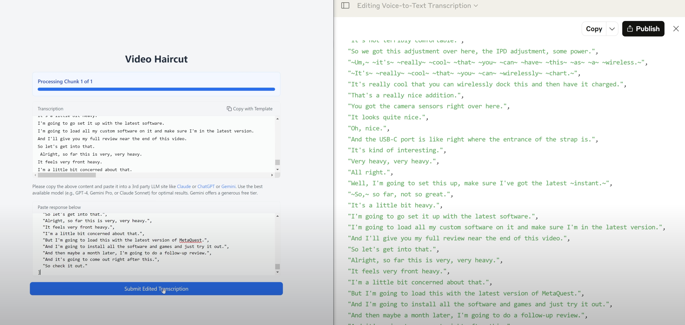

# Video Haircut - AI-Powered Video Editing Assistant

## [⬇️ DOWNLOAD NOW](https://github.com/js-commit/video-haircut/releases)

Save hours on video editing with Video Haircut - the AI tool that transforms raw talking head footage into polished content in minutes, not hours.

## Requirements
- Windows 10/11 or Mac M series
- Video editor that supports XML sequence import
- For multicam, download the free [TimeBolt plugin](https://www.timebolt.io/jump-cutter-adobe-premiere) to apply cuts in Premiere Pro only (more formats to follow)

## See It In Action!

---

  
   
  <em>Video Haircut: Instantly find and cut silences, filler words, and bad takes with AI</em>

## How It Works

1. **Record your content** - Just talk naturally, don't worry about mistakes
2. **Import into Video Haircut** - The app automatically transcribes your video
3. **Edit with AI** - Use AI to suggest cuts or make your own text-based edits
4. **Export to your editor** - Take the edits to Premiere Pro, Final Cut, DaVinci Resolve, or any NLE

## Key Features

- **⚡️ Blazing Fast Workflow** - What used to take hours now takes minutes
- **✏️ Text-Based Editing** - Edit your video just like you'd edit a document
- **🤖 AI-Powered Edits** - Use AI to automatically clean up your content
- **🎬 Editor Agnostic** - Works with any NLE software you already use
- **🎥 Premiere Pro Multicam Support** - Works with TimeBolt plugin for multicam editing
- **⌨️ Keyboard Shortcuts** - Designed for power users who value speed
- **🔑 Use Your Own LLM** - Connect to Claude Sonnet 3.7, Gemini Pro 2.5, or other models
- **💸 No Subscription Fees** - Free to use for a limited time, no recurring costs ever

## Why Video Haircut?

Unlike other AI video editors, Video Haircut:

- **Isn't locked to specific AI models** - Use whatever LLM you have access to
- **Doesn't require expensive subscriptions** - Pay once, use forever
- **Works with your existing workflow** - Export to any editing software
- **Focuses on what AI does best** - Finding cuts and edits in talking head videos
- **Preserves your creative control** - AI assists but doesn't take over

## Getting Started

1. Download the latest release for your platform
2. Import your video file
3. Let Video Haircut transcribe your content
4. Edit using AI suggestions or manually mark cuts
5. Export to your favorite editor

## Perfect For

- **YouTubers** creating regular talking-head content
- **Content creators** who want to speed up their workflow
- **Solo videographers** who need to wear multiple hats
- **Podcasters** transitioning to video content
- **Anyone** who wants to cut editing time by 80%

## Support & Feedback

Have questions or suggestions? [Open an issue](https://github.com/js-commit/video-haircut/issues)

---

Video Haircut is currently free for a limited time during our initial release phase. No subscription will ever be required.
